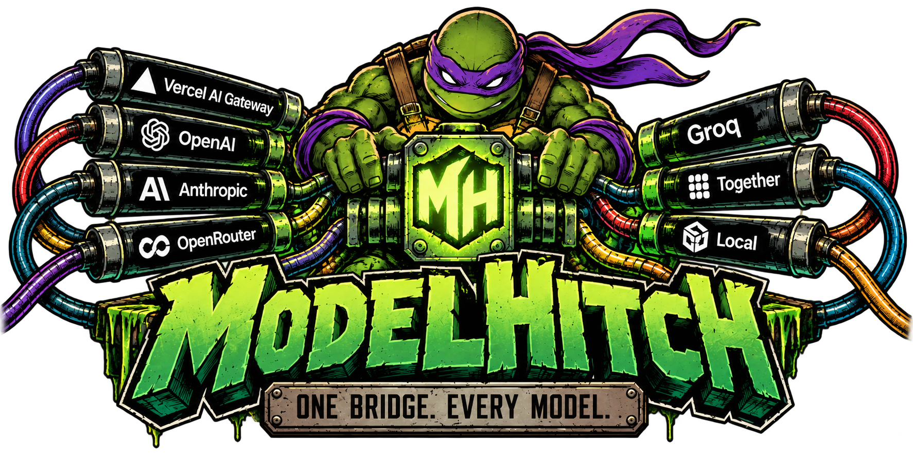
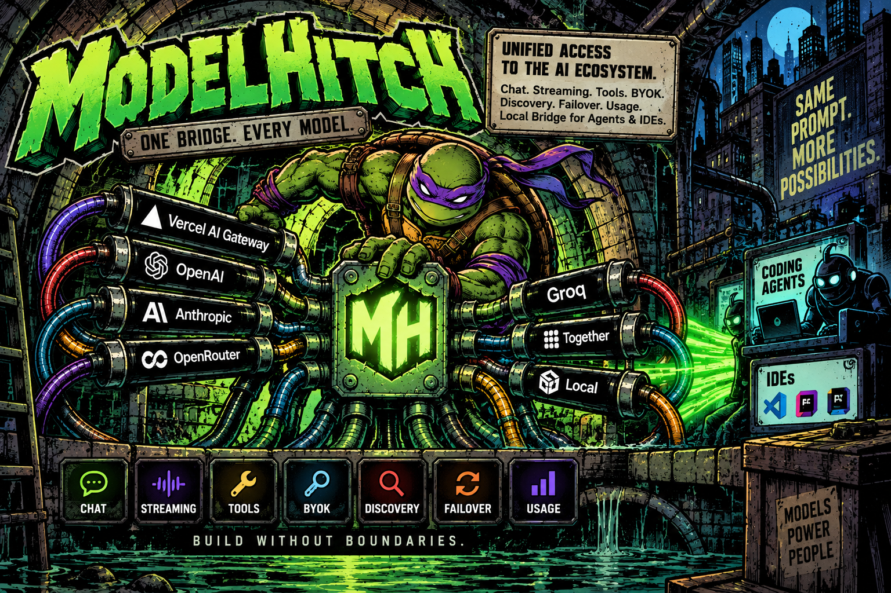
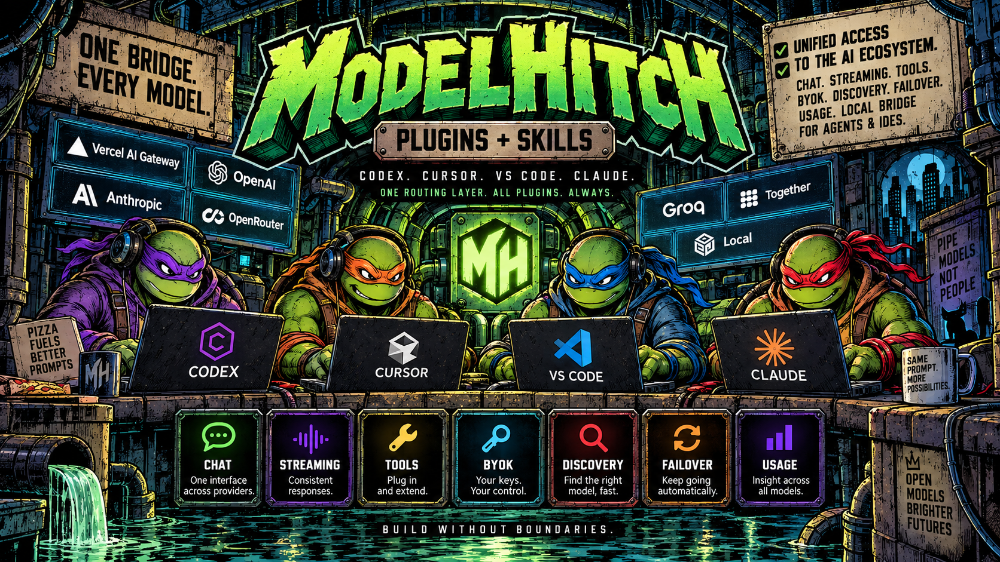
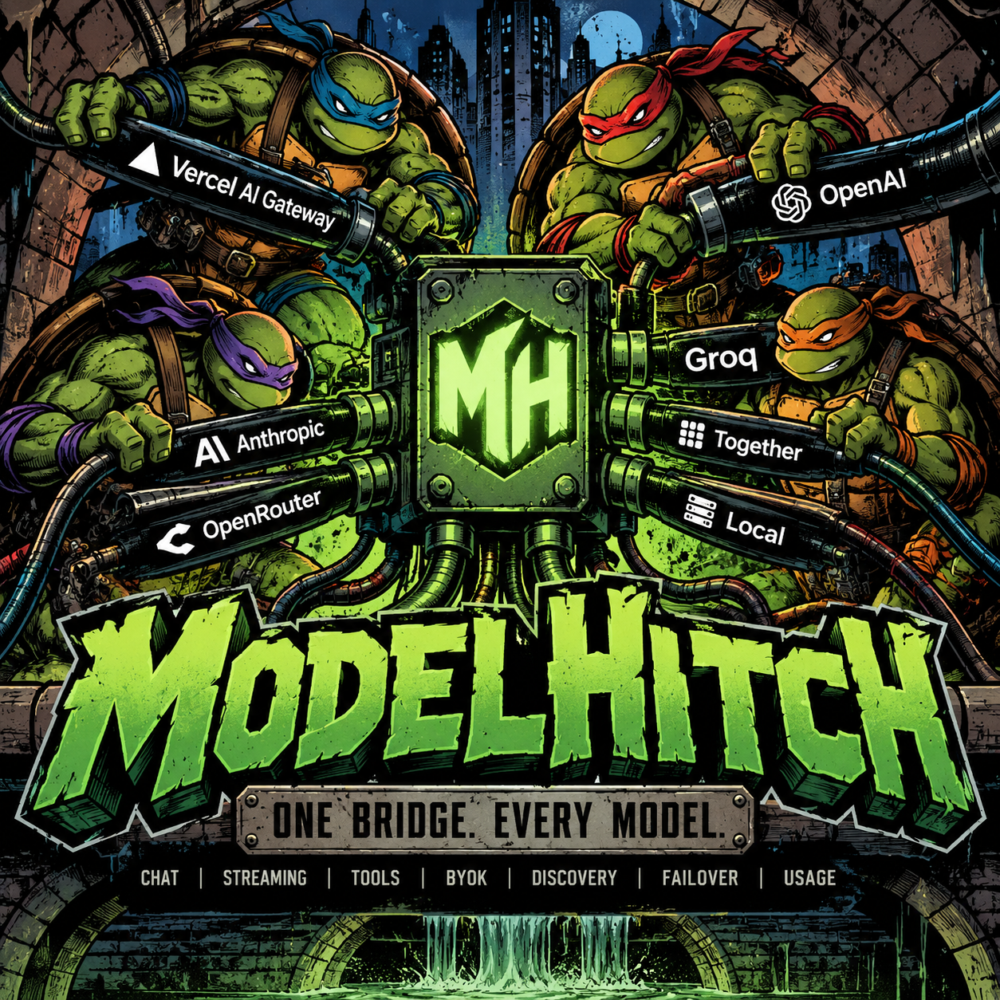
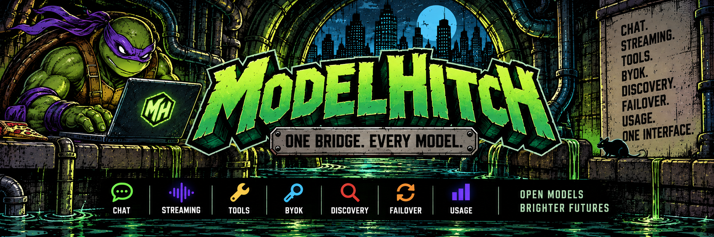

<p align="center">
  
</p>

<p align="center">
  <strong>Hitch any model to your app.</strong><br/>
  One TypeScript API. Your keys. Hosted or local. No runtime dependencies.
</p>

<p align="center">
  <a href="https://www.npmjs.com/package/modelhitch"></a>
  <a href="https://www.npmjs.com/package/modelhitch"></a>
  <a href="./LICENSE"></a>
  
  
</p>

<p align="center">
  <a href="#install">Install</a> ·
  <a href="#agent-skills--plugins">Agent skills</a> ·
  <a href="#what-you-get">Features</a> ·
  <a href="./docs/guide.md">Guide</a> ·
  <a href="./examples">Examples</a>
</p>

> Provider harness by day. Temp agency for LLMs by accident.

<p align="center">
  
</p>

Chat, stream, tools, BYOK, discovery, failover, and usage — one API across hosted and local models, plus a local multi-wire bridge for agents and IDEs.

## Install

```bash
npm install modelhitch
```

```ts
import { ModelHitch } from 'modelhitch';

const mh = new ModelHitch();
const result = await mh.chat({
  provider: 'vercel-ai-gateway',
  model: 'openai/gpt-5.4',
  messages: [{ role: 'user', content: 'Clock in.' }],
});

console.log(result.message.content);
```

Same provider-neutral types for chat, streaming, tools, custom providers, and React hooks.  
[Technical guide →](./docs/guide.md)

## Agent skills + plugins

<p align="center">
  
</p>

```bash
npx modelhitch setup codex    # claude | cursor | vscode | all
npx modelhitch setup zstack   # install zstack workflow across agents
```

Defaults to a personal install. Add `--project`, `--dry-run`, or `--force` as needed.

| Agent | Skill command | Full package |
| --- | --- | --- |
| **Codex** | `npx modelhitch setup codex` | [Plugin guide](./.agents/plugins/README.md) |
| **Claude** | `npx modelhitch setup claude` | [Two-skill guide](./.claude/skills/README.md) |
| **Cursor** | `npx modelhitch setup cursor` | [Plugin guide](./.cursor-plugin/README.md) |
| **VS Code / Copilot** | `npx modelhitch setup vscode` | [Agent Plugin guide](./.github/plugin/README.md) |

## What you get

<p align="center">
  
</p>

| Surface | Included |
| --- | --- |
| **Library** | `chat`, `stream`, tools, model discovery, typed errors, custom providers |
| **Web apps** | Browser bundler support via `modelhitch/browser` — no Node polyfills |
| **Android** | Native Kotlin SDK, coroutine streaming, Compose sample, Keystore BYOK |
| **Flutter** | Dart SDK, SSE streaming, secure BYOK, OpenAI-compatible providers |
| **Electron** | Desktop adapter, `safeStorage` BYOK, renderer IPC, browser-safe bundling |
| **BYOK** | Request keys, memory store, browser local storage, env fallback |
| **ChatGPT plan** | Spend a signed-in ChatGPT plan as a lane: rotate to it, pin it, or route to it explicitly (`chatgpt-plan`). OAuth, no API key |
| **React** | `useChat`, `useStream`, bridge client via `modelhitch/react` |
| **Bridge** | OpenAI Chat/Responses/Images, Anthropic Messages, Gemini GenerateContent |
| **Reliability** | Automatic 429/5xx/network failover across models and providers |
| **Usage** | Tokens, estimated spend, latency, failovers, dashboard, optional SQLite |

### Providers

`Vercel AI Gateway` · `OpenAI` · `Anthropic` · `Groq` · `OpenRouter` ·
`Together AI` · `HuggingFace` · `Google Gemini` · `DeepSeek` · `xAI` ·
`Mistral` · `Moonshot` · `Z.ai (GLM)` · `LM Studio` · `Ollama` · `vLLM` · `llama.cpp` ·
`KoboldCpp` · `mock`

Plus the opt-in lanes you configure: `chatgpt-plan` (Sign in with ChatGPT), `custom-<slug>`
(any endpoint you name), and `opencode-byok-<slug>` (OpenCode Console connections).

## Android SDK

Native Kotlin for Android 6.0+ — no Node/JS runtime embedded.

- Provider-neutral chat types + `Flow` streaming + tool-call events
- Built-in OpenAI-compatible providers, typed errors, model listing
- AES-GCM credentials via Android Keystore

```kotlin
dependencies {
  implementation("io.github.bobbybacklogs.modelhitch:modelhitch-android:0.1.0")
}
```

```kotlin
val keys = AndroidKeyStoreCredentialStore(applicationContext)
keys.set(selectedProviderId, userProvidedKey)

val hitch = ModelHitch(
  providers = DefaultProviders.all,
  keyStore = keys,
)

hitch.stream(
  ChatRequest(
    provider = selectedProviderId,
    model = selectedModelId,
    messages = listOf(ModelMessage.User(text("Hello from Android"))),
  ),
).collect { chunk ->
  if (chunk is StreamChunk.TextDelta) append(chunk.text)
}
```

[Android guide →](./android-sdk/README.md)

## Dart and Flutter SDKs

Dart 3.4 core + Flutter 3.22 adapter in [`flutter-sdk`](./flutter-sdk).

- `modelhitch_dart` — types, OpenAI-compatible transport, SSE streams, errors, listing
- `modelhitch_flutter` — same core + encrypted BYOK via `flutter_secure_storage`
- Device-user keys only; app-owned credentials should hit a backend or bridge

```yaml
dependencies:
  modelhitch_flutter: ^0.1.0
```

```dart
final hitch = ModelHitch(keyStore: FlutterSecureKeyStore());

hitch.stream(
  ChatRequest(
    provider: 'openai',
    model: 'gpt-4o-mini',
    messages: [ModelMessage.user(MessageContent.text('Hello from Flutter'))],
  ),
).listen((chunk) {
  if (chunk case TextDelta(:final text)) append(text);
});
```

[Dart/Flutter guide →](./flutter-sdk/README.md)

## Expo / React Native SDK

Thin adapter over `modelhitch` for Expo SDK 52+ and React Native.

- `expo/fetch` streaming + `expo-secure-store` BYOK
- Metro-safe entry (no Node-only modules)
- Same BYOK contract as Android/Dart — iOS, Android, and Expo web

```bash
npx expo install expo-secure-store
npm install modelhitch modelhitch-expo
```

```ts
import { createExpoModelHitch } from 'modelhitch-expo';

const mh = createExpoModelHitch({ defaultProviderId: 'openai' });
await mh.keystore?.set('openai', keyPastedByUser);

const stream = await mh.stream({
  model: 'gpt-4o-mini',
  messages: [{ role: 'user', content: 'Hello from Expo' }],
});

for await (const chunk of stream) {
  if (chunk.type === 'text-delta') appendText(chunk.text);
}
```

[Expo guide →](./expo-sdk/README.md)

## Electron SDK

Thin adapter over `modelhitch` for Electron 28+ desktop apps.

- `safeStorage` BYOK + renderer IPC helpers
- Bundler-safe entry (no Node-only modules in renderer bundles)
- Same BYOK contract as Android/Dart/Expo — macOS, Windows, and Linux

```bash
npm install modelhitch modelhitch-electron
```

```ts
import { createElectronModelHitch } from 'modelhitch-electron';

const mh = createElectronModelHitch({ defaultProviderId: 'openai' });
await mh.keystore?.set('openai', keyPastedByUser);

const stream = await mh.stream({
  model: 'gpt-4o-mini',
  messages: [{ role: 'user', content: 'Hello from Electron' }],
});

for await (const chunk of stream) {
  if (chunk.type === 'text-delta') appendText(chunk.text);
}
```

[Electron guide →](./electron-sdk/README.md)

## Local agent bridge

```bash
npx modelhitch bridge --background
npx modelhitch status
npx modelhitch settings
```

| | |
| --- | --- |
| **Endpoint** | `http://127.0.0.1:3939/v1` — route as `providerId/modelId` |
| **Usage** | `http://127.0.0.1:3939/usage` |
| **Settings** | Web UI or `modelhitch settings` (OpenTUI; Bun required for the TUI) |
| **Image lane** | Off by default — enable in settings or with `--image-lane` |
| **Runtime** | Bridge needs Node 22.5+ (SQLite); library supports Node 18+ |

### One id for the whole rotation

A client that treats the bridge as a custom endpoint still has to name a model, and every name it
could save is one lane. `modelhitch/auto` is the bridge's own: send it and the request routes
exactly as one that omits `model` does, with the rotation behind it.

| | |
| --- | --- |
| **Ask for it** | `"model": "modelhitch/auto"` on any wire — or `modelhitch/auto` in a Gemini path |
| **What it means** | The plan: the default lane leads, then the trusted/fallback (or auto-mode) lanes behind it. A `--provider` pin still applies |
| **Where it is listed** | First in `GET /v1/models` as `ModelHitch Auto · whole rotation · N lanes`, carrying the lanes it expands to in `modelhitch.lanes` |
| **Lane ids still mean lanes** | Picking a lane leads with the rest of the plan behind it. The auto id is the only id that stands for more than the one lane it names |

### Pin one provider

```bash
npx modelhitch bridge --background --provider opencode-go
```

The pinned provider becomes the lane every request prefers — including requests that name a
different provider — and the route the pin displaced is tried next, so a depleted or erroring
provider still rotates on to a working one. Pin to a provider the bridge does not serve and it
refuses to start with the available ids. The pin lives only in that process: restart without
`--provider` and the configured rotation is back. `modelhitch status` shows the active pin.

### OpenCode Console BYOK

Console [BYOK](https://opencode.ai/v2/docs/console/byok/) links a provider account you already
pay for to an OpenCode workspace. Each connection gets one gateway URL and authenticates with a
Console service-account key, so the provider secret never reaches this machine. ModelHitch serves
each connection as its own provider lane — `opencode-byok-<slug>` — which means it rotates,
cools, and pins like every other provider:

```bash
# rotate across the connections configured in /settings
npx modelhitch bridge --background --opencode-byok

# or pin one connection for this process
npx modelhitch bridge --background --provider opencode-byok-deepseek
```

In `/settings` → **OpenCode Console BYOK**: paste the Console API URL (or the bare `conn_…` id),
list the models the connection enables, and choose `rotation` (spread across every connection) or
`pinned` (one connection first). **Import from OpenCode** reads your local OpenCode install
(`auth.json`, `opencode.db` message history, `opencode.jsonc`) and seeds connections with the
models you actually run; `--opencode-byok-sync` does the same at bridge start. The Console key is
reused from the OpenCode key in settings (`keys.opencode` / `OPENCODE_API_KEY`) unless you paste a
dedicated one.

| | |
| --- | --- |
| **Schema** | Per connection: `auto`, `chat-completions`, `responses`, `anthropic`, `google` |
| **Provider id** | `opencode-byok-<slug>` — usable in policy lanes and `--provider` |
| **Keys** | `keys.opencode` shared · `keys.opencode-byok` or `keys.opencode-byok-<slug>` to override |

### Custom BYOK lanes

For a key to a provider ModelHitch does not list: a self-hosted gateway, a regional reseller, an
internal deployment. You supply the endpoint, the key, and the model slots, and the lane behaves
like any other provider. There is no catalog to import from, so a custom lane is **never** polled
for models — the ids you type are exactly what it serves.

```bash
npx modelhitch bridge --background \
  --custom-lanes \
  --custom-lane upstream --custom-lane-url https://api.example.com/v1 \
  --custom-lane-models fast-model,smart-model --custom-lane-schema chat-completions \
  --custom-lane-on-limit stop
```

In `/settings` → **Custom lanes**: add a lane, paste the endpoint, type the model slots, pick the
schema, and choose what hitting a limit means. `placement` decides where the lanes sit — `lead`
(default) routes to them first with your configured lanes directly behind as the safety net,
`fallback` keeps the buffet primary and uses the custom lanes only when it is depleted.

| | |
| --- | --- |
| **Schema** | Per lane: `auto` (detect from the model family), `chat-completions`, `responses`, `anthropic`, `google` |
| **Provider id** | `custom-<slug>` — usable in policy lanes, the lane-health table, and `--provider` |
| **Keys** | `keys.custom-<slug>` · the lane's `apiKeyEnvVar` · `MODELHITCH_CUSTOM_<ID>_API_KEY` · `requiresKey: false` for a keyless endpoint |
| **On limit** | `rotate` (default) fails over like every lane · `stop` is terminal: a 429/402/5xx surfaces instead of spending another provider, and keeps stopping while the lane is parked |

[Bridge guide →](./docs/guide.md#custom-byok-lanes) · [agent-runtime scaffold (Eve-shaped filesystem-first durable agent) →](./agent-runtime/README.md)

### Sign in with ChatGPT

Spend the ChatGPT plan the user already pays for, instead of an API key. You sign in once in the
system browser, and ModelHitch serves `chatgpt-plan` as an ordinary lane: rotate to it, pin it as
the main route, cool it down on a limit, or route to it explicitly as `chatgpt-plan/<model>`.

```bash
# sign in first (opens your browser, loopback callback, no client secret)
npx modelhitch chatgpt-plan sign-in

# then serve it as the main route, with the buffet directly behind it
npx modelhitch bridge --background --chatgpt-plan
```

`/settings` → **Sign in with ChatGPT** has the same flow with a **Continue with ChatGPT** button,
plus rotation, pin, placement, and model-slot controls.

| | |
| --- | --- |
| **Provider id** | `chatgpt-plan` |
| **Credentials** | OAuth grant in `~/.modelhitch/chatgpt-plan.json` (owner-only). Never an API key, never in `config.json` |
| **Models** | Read from the signed-in account's `GET /v1/models`, or name slots yourself. ModelHitch never guesses a slug |
| **Mode** | `rotation` spreads requests over the model slots · `pinned` leads on one model with its siblings as the first fallback |
| **Placement** | `lead` (default) spends the plan first, `fallback` uses it only once the configured lanes are depleted |
| **On limit** | `rotate` (default) fails over like any 429 · `stop` makes the lane terminal |
| **Requires** | `store: false` and `stream: true` on every request, which this route mandates. `temperature` and `maxTokens` are not sent |

OpenAI's preview route rejects several fields the normal API accepts and only counts a response as
complete on `response.completed`. Both are enforced in the adapter, and the plan-usage settings link
travels with a limit error so the caller can act on it.

[ChatGPT plan lane guide →](./docs/guide.md#sign-in-with-chatgpt) · [Sign in with ChatGPT spec →](https://developers.openai.com/siwc/token-sharing-open-source)
### Agent lanes

Two lanes do agent-shaped work — a prompt in, a durable session out — behind one set of routes, so
a client does not need to know which one is serving.

|  | Cursor Cloud Agent | Local agent |
| --- | --- | --- |
| **Where it runs** | Cursor's cloud, against a repo it checks out | A working tree on this machine |
| **Needs** | `CURSOR_API_KEY` | Nothing beyond the bridge's own provider |
| **Runs while** | The vendor holds it — survives a bridge restart | The bridge process is alive |
| **Config** | `cloudAgent` | `localAgent` |

Both are **off by default**, and both answer the same routes:

```bash
# what is running (both lanes merge into one list)
curl http://127.0.0.1:3939/v1/cloud-agents

# start a run (local lane only; the remote lane's runs go through the chat wires)
curl -X POST http://127.0.0.1:3939/v1/cloud-agents/run \
  -H 'Content-Type: application/json' \
  -d '{"prompt":"Read hello.txt and tell me its contents","sessionId":"conv-1"}'

curl -X POST http://127.0.0.1:3939/v1/cloud-agents/<id>/cancel
```

**The local lane requires an explicit `workspaceDir`.** There is no fallback to the current
directory on purpose: a bridge started from a repo root would otherwise hand the agent read/write
over that entire repository. Without it the lane reports itself not-ready and refuses to run.

```jsonc
{
  "localAgent": {
    "enabled": true,
    "workspaceDir": "C:\\work\\scratch",  // required — the agent may only work here
    "maxTurns": 8,
    "model": "opencode-go/deepseek-v4-flash"  // optional; defaults to the configured lane
  }
}
```

Conversations map to sessions durably (`~/.modelhitch/cloud-agents/`), so a restarted bridge
continues the existing session rather than forking a new one. Cursor runs are owned by Cursor the
same way; a local run that was still **in flight** when the bridge died does not survive, because
there is no supervisor yet — only completed sessions are durable.

[Bridge guide →](./docs/guide.md) · [agent-runtime scaffold →](./agent-runtime/README.md)
## Development

```bash
npm install
npm run typecheck
npm test
npm run build
```

Try without a key: [quickstart](./examples/quickstart.ts), [BYOK UI](./examples/byok-ui), [Expo app](./examples/expo-app) (mock provider). MIT licensed — public contributions are currently closed.

<p align="center">
  
</p>
