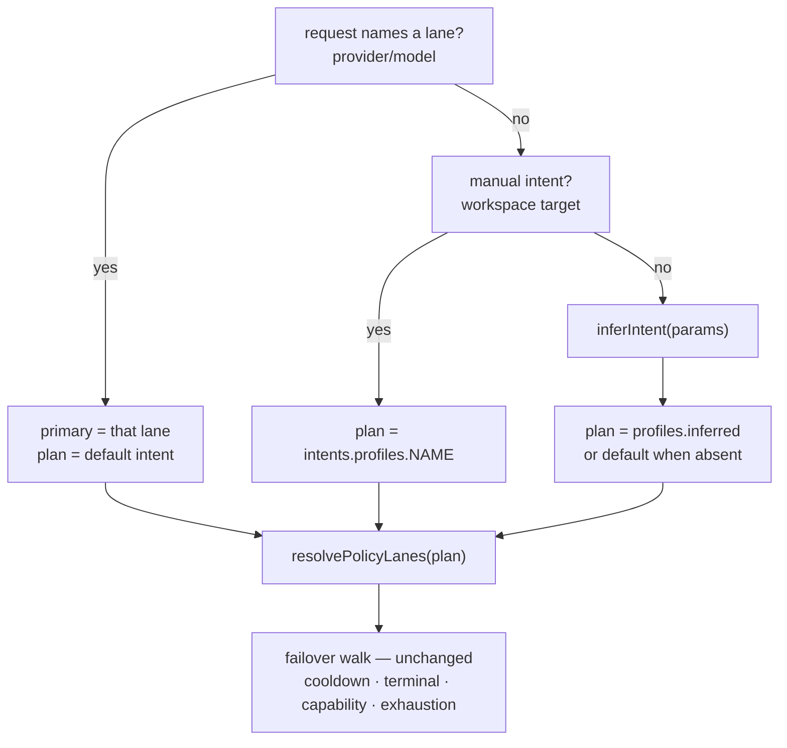

# Intent rotation

Rotate by *intent* — route a request to a plan that matches the work, instead of
rotating one plan for every request.

Status: **all four phases landed** (2026-10-12).

| Phase | Delivers | State |
| --- | --- | --- |
| 0 | `src/core/intent.ts`, config types, validation, tests | **Landed** |
| 1 | `config.intents`, server inference, `lanesForRoute` | **Landed** |
| 2 | catalog entries + `modelhitch/auto:<intent>` routing | **Landed** |
| 3 | library client + workspace `RunTarget` + pickers | **Landed** |
| 4 | usage attribution + settings editor | **Landed** |

---

## 1. The model

An **intent is a named plan** — an ordered lane list with its own `Policy`.
Resolution picks the plan, then the *existing* failover walk runs unchanged.
No new routing subsystem, no new lane type: an intent is still just lanes.



`modelhitch/auto` remains the one id that stands for more than a lane. Intents
are reached **only by naming no lane**, which is the rule the bridge already
documents.

## 2. Vocabulary (fixed)

| Intent | Shape it describes | Reached by |
| --- | --- | --- |
| `coding` | agentic work with a tool loop already in flight | inference |
| `reasoning` | long-context, deep single shot | inference |
| `vision` | image content present | inference |
| `bulk` | one-shot, no tools, explicitly capped short output | inference |
| `default` | everything else | the existing `config.policy` |

Four profiles plus the implicit default. `default` is never written under
`intents` — it *is* `policy`, which is what keeps this backward compatible.

## 3. Inference — pure, deterministic, no I/O

`inferIntent()` is a pure function of the request params, shaped like the
existing `inferRequirements()` precedent in `src/core/capabilities.ts`.

First match wins:

| # | Intent | Evidence |
| --- | --- | --- |
| 1 | `vision` | any message content array holds `{type:'image'}` or `{type:'image-data'}` |
| 2 | `coding` | a tool loop is already in flight: a `role:'tool'` message, or an assistant message carrying `toolCalls` |
| 3 | *(stop)* | `tools` are present but no loop evidence → **ambiguous, stay on `default`** |
| 4 | `reasoning` | input ≥ `REASONING_MIN_CHARS`, or an assistant message carries `reasoningContent` |
| 5 | `bulk` | no conversation history **and** input ≤ `BULK_MAX_CHARS` **and** an explicit `maxTokens` ≤ `BULK_MAX_TOKENS` |
| 6 | *(stop)* | nothing matched → `default` |

### Tools are a capability signal, not proof of coding intent

A request that *offers* tools has not told us it is coding work — a weather
lookup, a document search, and a refactor all ship a `tools` array. So tools
present, on its own, deliberately resolves to `default` rather than guessing
`coding`, and it also short-circuits the `reasoning`/`bulk` rules: when the
intent is ambiguous we do not guess confidently in *either* direction.

The one thing that does establish coding is a **tool loop already in flight** —
a `tool` message or an assistant `toolCalls` block means the conversation is
agentic in fact, not just capable of it. That is evidence, not capability.

### Bulk needs declared low-complexity work, not brevity

A short prompt is just a short prompt — "yes", "continue", "what's the
status?" are short and would otherwise be routed to a cheap lane on no
evidence. `bulk` therefore requires all three of:

- no conversation history (no assistant or tool messages),
- input ≤ `BULK_MAX_CHARS` (800), and
- `maxTokens` **explicitly set** and ≤ `BULK_MAX_TOKENS` (256).

The explicit output cap is the load-bearing signal: the caller declared a small
budget for this request. Anything less specific falls back to `default`.

### Thresholds

Exported constants, so tests can assert the boundary and users can see the line:

| Constant | Value | Meaning |
| --- | --- | --- |
| `REASONING_MIN_CHARS` | `24_000` | ≈ 6k tokens; at or above this the request reads as long-context |
| `BULK_MAX_CHARS` | `800` | at or below this a request *may* be bulk |
| `BULK_MAX_TOKENS` | `256` | an explicit output cap this small is bulk evidence |

`inputCharacters()` counts **textual** input only — `text` parts, string
contents, and `role:'tool'` contents. Image payloads are excluded, because a
single base64 screenshot would otherwise dwarf every threshold and classify
itself as long-context.

Two properties that matter:

- **Vision outranks everything.** A screenshot *with* tools is a vision
  request: lane capability is what is being selected, and only vision lanes can
  serve it.
- **Inference never fails a request.** It is advisory. An unmatched, unknown, or
  unconfigured intent falls through to `default`. It cannot produce a 400. (The
  one refusal is an *explicitly written* unknown id — see §4.)

## 4. Selection and precedence

| Priority | Source | Wins when |
| --- | --- | --- |
| 0 | **The id itself** — `modelhitch/auto:coding` | the client named an intent |
| 1 | Manual target (workspace session / work order) | the user picked an intent |
| 2 | Inference from request shape | no lane named, no pinned intent, `intents.infer` not `false` |
| 3 | `default` (`config.policy`) | everything else, or the named profile is not configured |

`rotation` keeps its current meaning — "I am not pinning anything" — and now
reads as *the bridge decides*: infer, else default. That is what gives the
workspace path inference without adding a fourth option to the picker.

### The pinned id: `modelhitch/auto:<intent>`

The plain auto id is the right default and the wrong thing to hand a client that
has a lane choice to make: it means "whichever plan the request's shape selects",
which is not a choice anyone can save. The pinned form is how a *picker* offers
that choice — every configured profile gets a row, the row's id names the
profile, and sending it back routes to exactly that plan with nothing inferred.

| Id | Means |
| --- | --- |
| `modelhitch/auto` | the plan the request's own shape selects — still infers |
| `modelhitch/auto:coding` | the `coding` profile, whatever the body looks like |
| `modelhitch/auto:reasoning` (no such profile) | the intent is real, the profile is not — falls back to the base plan |
| `modelhitch/auto:refactor` | `404 model-not-found`, naming the vocabulary |

The unknown-name case is the one place an intent is an error rather than a
fallback. An **inferred** intent can never fail a request — there is no
instruction to disobey — but an **explicitly written** id that names nothing the
bridge knows is a typo, and passing it to a provider as if it were a model would
surface as an opaque upstream failure. The name is fixed rather than
configurable for the same reason the auto id is: a client's saved config has to
keep meaning the same request after the bridge behind it changes.

`isIntentModelIdShape` answers "is this shaped like an intent id" separately
from `intentFromModelId`, which answers "is this one I can route". The server
needs both to refuse an unknown name crisply.

## 5. Config shape

```jsonc
{
  "version": 1,
  "policy": { "trusted": [ /* the default plan — unchanged */ ] },
  "intents": {
    "infer": true,                      // inference on by default; false = exactly today's behaviour
    "profiles": {
      "coding":    { "trusted": [ { "providerId": "opencode-byok-anthropic", "models": ["claude-sonnet-4.6"] } ], "fallback": [] },
      "reasoning": { "trusted": [ /* ... */ ] },
      "vision":    { "trusted": [ /* ... */ ] },
      "bulk":      { "trusted": [ /* ... */ ], "maxProviders": 1 }
    }
  }
}
```

A profile value is a full `Policy`, so `maxProviders`, `backoff`,
`retryableCodes` and `terminal` lanes work per intent for free.

- Unknown profile names are a validation **error** (a typo, reported with the
  known list).
- A *missing* profile is fine and falls back to `default`.
- `intents.infer: false` restores today's behaviour exactly.
> **Settings Apply.** `intents` is in the CLI's "optional keys absent from the
> incoming document get cleared" list, so an emptied editor removes the block.
> It was added to that list only once the editor existed — while there was no
> way to turn the block off in the UI, listing it would have wiped a hand-edited
> config on every Apply. A key belongs in that list exactly when the settings
> page can turn it off.
## 6. Code map

| File | Change | Phase |
| --- | --- | --- |
| `src/core/intent.ts` | **new, pure** — vocabulary, thresholds, `inputCharacters`, `inferIntent`, `intentPolicy`, `inferenceEnabled`, `validateIntents` / `validateIntentsShape` / `validateIntentProfiles` | 0 ✅ |
| `src/server/server.ts` | `intents` option, `intentFor` / `policyFor`, `lanesForRoute(route, intent, credentials?)`, intent-scoped walk parameters | 1 ✅ |
| `src/config.ts` | `intents?: IntentsConfig`; shape + names in `validateConfig`, provider-aware pass in `validateConfigWithSource` | 1 ✅ |
| `src/cli.ts` | passes `config.intents` at startup and through every `reconfigure` | 1 ✅ |
| `src/index.ts` | exports the intent surface | 1 ✅ |
| `src/client.ts` | `intents` option, `ChatInput.intent`, `intentFor` / `policyFor`, per-call walk parameters | 3 ✅ |
| `src/server/lane-catalog.ts` | intent id grammar (`intentModelId` / `intentFromModelId` / `isIntentModelIdShape`), `intentModelEntry`, `AutoModelMeta.intent` | 2 ✅ |
| `src/server/server.ts` | `resolveRequestModel` (id → model + pinned intent), a row per configured profile in `modelCatalog` | 2 ✅ |
| `src/workspace/types.ts` | `RunTarget` gains `{ kind: 'intent'; name: IntentName }` | 3 ✅ |
| `src/server/workspace-http.ts` | `parseTarget` accepts it; `chatInputForTarget` passes `intent` (`'default'` for a pinned lane) | 3 ✅ |
| `src/workspace-page.ts` | both pickers list the published intent ids above the lanes | 3 ✅ |
| `src/settings-page.ts` | intent editor — one lane list per profile and tier, an infer toggle, `collectIntents()` | 4 ✅ |
| `src/core/usage.ts` | `UsageEvent.intent`, `perIntent` on every slice, a **Plans** panel and a per-event intent pill | 4 ✅ |
| `src/core/usage-storage.ts` | an `intent` column, added in place on databases written before it existed | 4 ✅ |

Config types and validation live in `src/core/intent.ts` rather than the
originally sketched `src/core/policy.ts`, so the dependency runs one way
(`intent → policy`) and the two modules cannot form a cycle.

`validateIntents` is split in two because the config loader runs without a
warmed provider source (`validateConfigWithSource(loaded)` is called with no
source at startup), while the settings Apply path has one. `validateIntentsShape`
owns shape and names and needs no source; `validateIntentProfiles` owns the
provider-aware per-profile pass; `validateIntents` composes them for callers
that want one call. Splitting them keeps a typo'd profile name reported exactly
once on both paths.

### Phase 1 landing notes

- The intent is resolved **once per request in the handler** (not inside
  `lanesForRoute`) and passed to the stream writers, so a request's plan cannot
  differ between its streaming and non-stream forms.
- A request that **names a lane** (`requestedModel` defined) always resolves to
  the default intent — decision 2, enforced at `intentFor`.
- Walk parameters follow the request's plan, not the server's: `retryableCodes`,
  `maxAttempts` and `backoff` all read `policyFor(intent)`. This is
  load-bearing, not cosmetic — an intent-only config (profiles, no base
  `policy`) otherwise fell into the auto-mode branch and capped the walk at one
  attempt, so its lanes were resolved and never tried. A server with profiles
  and no base policy now also builds a cooldown.
- The `/v1/models` catalog publishes the **base** plan's lanes plus one
  `modelhitch/auto:<intent>` row per configured profile (Phase 2), ordered:
  plain auto id, pinned intent rows in vocabulary order, then the lanes. A
  profile with no reachable lane publishes nothing. Both forms carry
  `modelhitch.kind === 'auto'`, so the settings and workspace pickers filter
  them the same way — Phase 3/4 surface them on purpose.

Publishing `modelhitch/auto:coding` in the catalog means the published id must
be routable, so `normalizeModel` learns the `auto:<name>` form (~10 lines).
That is the only piece touching the id grammar, and it is implied by making
intents visible at all.

### The workspace composer

The `/workspace` pickers are a third way in, and they take a *different* code
path from every client above: the composer calls the **library client**
(`ModelHitch.chat`), not the bridge's own router. Both paths have to agree, so
the library got the same `intents` option and the same per-call resolution.

| Target | Sends | Means |
| --- | --- | --- |
| `rotation` | no `intent` | the library infers from the request, else the base plan |
| `{ kind: 'intent', name }` | `intent: name` | that profile's plan, whatever the request looks like |
| `{ kind: 'model', … }` | `intent: 'default'` | one lane, base plan behind it — no inference |

The picker offers `rotation`, then the published intent ids, then the lanes —
read straight out of `GET /v1/models`, which already lists them (Phase 2). The
plain auto row is skipped as before (it *is* the `rotation` option); the pinned
rows are surfaced on purpose, since both carry `kind: 'auto'`.

`ChatInput.intent` accepting `'default'` is what lets a caller that has already
named a lane say "do not guess" — the information lives at the call site, where
the pin is known, rather than being re-derived from `provider`/`model` being set
(which the rotation path sets too).

### Phase 3 landing notes

- The library's `delayBeforeFailover` now takes the policy as a parameter: a plan
  is per-call once intents exist, so it cannot be instance state. `tests/policy.test.ts`
  reaches that private method and was adapted with it.
- A server/client with intent profiles and **no base `policy`** now builds a
  cooldown and walks its lanes in full (same fix as Phase 1, mirrored).
- Verified in a browser against a scratch config: the picker renders
  `rotation`, `ModelHitch Auto · coding · 1 lane`, `ModelHitch Auto · bulk · 1 lane`,
  then the lanes; `1440×900` and `390×844` both show no sideways overflow (rail
  stacks below 900px); the only request ≥ 400 is the documented
  `GET /v1/cloud-agents` 403.

## 7. What does *not* change

- **Lane health stays global** — keyed by `providerId/model`. A lane parked by a
  coding request is parked for bulk too. One lane, one health state.
- **Capability skipping stays per-request** and still never cools a lane.
- `terminal` / `stop` lanes, `maxProviders` trimming, backoff, `ExhaustedError`,
  `Retry-After`, and the mid-stream abort rules are untouched — they all operate
  on the resolved lane list, which is still built by `resolvePolicyLanes`.
- The `--provider` pin still leads and still displaces one route, not the whole
  rotation.
- **A named lane still gets the `default` plan behind it.** Naming a lane is an
  explicit routing instruction; changing the rotation behind it based on content
  would be invisible to the caller. Applying intents behind named lanes is a
  one-line change if it is ever wanted, and deliberately not taken now.
- **A bridge with no `intents` block behaves exactly as it does today.**

## 8. Observability

- A log line only when inference actually steers the request:
  `intent=coding -> 3 lanes`. **Phase 1** — emitted once per request from
  `lanesForRoute`, and never for a default-intent request.
- `UsageEvent.intent` and a `perIntent` breakdown on every slice, so `/v1/usage`
  and the dashboard answer "what did each plan cost". **Phase 4** — grouped with
  `default` as the base-policy bucket, so the breakdown is total rather than
  having a silent remainder. Events recorded before the column existed load as
  `default`, which is what they were.

### Phase 4 landing notes

- The SQLite `usage_events` table gained an `intent` column. `CREATE TABLE IF NOT
  EXISTS` leaves an existing database with its old shape and the `INSERT` would
  fail on the missing column, so the storage adds it in place when
  `PRAGMA table_info` does not list it. Verified against a real pre-existing
  database: 2,106 historical events loaded and grouped as `default`.
- `reconfigure` keys the intents swap on **presence** (`'intents' in partial`),
  not on `!== undefined`, because a settings Apply clears the block and every CLI
  reconfigure passes the key either way.
- The editor reuses `laneRow`; the `+ lane` buttons carry their container id in
  `data-into`, so a profile's two lane lists need no bespoke wiring.
- `readLanes(container)` replaced the inline pass in `collectPolicy`, since the
  page now reads lane lists from five places instead of two.

## 9. Tests

`tests/intent.test.ts` (Phase 0):

- classifier truth table — all five outcomes,
- precedence collisions: image + tools → `vision`; tool loop + long input → `coding`,
- **tools present alone → `default`**, including long input with tools,
- `bulk` requires all three signals; each one removed → `default`,
- both character thresholds, at and across the boundary,
- `inputCharacters` excludes image payloads,
- `intentPolicy` fallback for unconfigured and unknown names,
- `validateIntents` — clean for `undefined`, error for an unknown profile name,
  nested policy errors prefixed with the intent path.

Phase 4 covered attribution and the editor: the tracker's `perIntent` split
(including `default` for events with no intent), the SQLite round-trip and the
column migration against a database whose schema predates it, a server-level
check that the hook reports exactly `coding, default, coding` for three requests
of different shapes plus the same split through `GET /v1/usage`, and a settings
suite that pins the editor's section ids, the `intents: collectIntents()`
payload key, and a drift guard asserting the page's vocabulary equals
`INTENT_NAMES` — a page offering a name the bridge cannot infer would let
someone configure a profile that never routes.

Phase 3 added a workspace suite: an intent target round-trips through a session,
a session and a work order both route through the plan their target pinned, a
rotation session and a pinned *lane* both stay on the base plan, an intent name
outside the vocabulary is a `400`, and — on the library side — inference, an
explicit intent, `intent: 'default'`, and `infer: false`. The workspace page
suite now runs the page's **own** `parseTargetValue` / `targetLabel` /
`buildTargetOptions` out of the served script rather than asserting on strings,
which is what makes the picker's behaviour actually covered.

**`tests/intent-routing.test.ts` landed in Phase 1** (13 tests) and grew in
Phase 2 to 24. It proves the routing, not just the classifier: the default route
always answers 429, so every request has to walk into its plan and the lane that
answers is read off the response body. Covered: one shape per profile, the two
ambiguity guards, the intent log line appearing only when inference steered, a
named lane getting the base plan, an unconfigured profile degrading to the base
plan, `infer:false`, no `intents` block at all, an intent-only config walking in
full, and the capability filter applying to the intent-selected plan.

Phase 2 added the pinned id to both halves of that suite: routing by id
overriding the body's shape, the plain auto id still inferring behind it, an
unconfigured pinned profile degrading, the `404` for an unknown name, and the
catalog side — row order, the profile's own lanes and label on the row, the
plain auto id staying intent-free, no row for an unconfigured profile,
`GET /v1/models/modelhitch/auto:coding`, and no intent rows at all without an
`intents` block. `tests/lane-catalog.test.ts` covers the id grammar purely.

## 10. Decisions

1. **`rotation` means "infer, else default"** rather than a flat default plan.
2. **A named lane ignores intents** and gets the default plan behind it.
3. **Tools present is a capability signal, not coding evidence** — ambiguous
   requests stay on `default` rather than guessing.
4. **Short is not bulk** — `bulk` needs no history, a short input, *and* an
   explicit small output cap.
